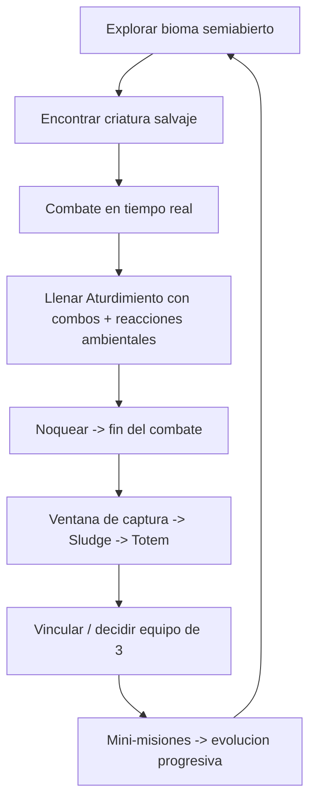
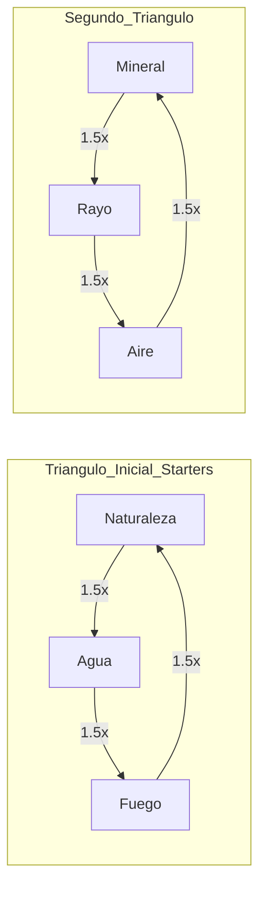

# Tatemis3D — Game Design Document

> **Nombre "Tatemis3D" es placeholder.**
> **Versión:** 0.1 — Draft inicial · **Motor:** Unity (URP)
> **Hecho por Arzpal** · Equipo de 3 (Arzpal: programación + diseño · 1 programador · 1 diseñador)
> **Estado:** Documento vivo. Se actualiza conforme se pulen decisiones. Las secciones marcadas 🔒 están cerradas; 🟡 en discusión; 🔮 futuro (fuera del slice).
>
> **Mapa:** §1 visión/pilares · §2 público/plataforma · §3 alcance del slice (IN/OUT) · §4 narrativa/lore · §5 core loop · §6 combate 🔒 · §7 elementos 🔒 · §8 ambiente/reacciones/captura 🔒 · §9 criaturas/progresión 🔒 · §10 Tamer 🔒 · §11 mundo · §12 multijugador 🔮 · §13 arte/audio · §14→ARCHITECTURE.md · §15→ROADMAP.md/TASKS.md · §16 riesgos · §17 glosario. → Ir a la sección que pida la tarea, no leer entero.

---

## 0. Cómo leer este documento

Este GDD describe la **visión completa del juego**, pero está escrito alrededor de una meta inmediata: **un vertical slice pulido para presentar la idea al studio**. Cada sistema indica si entra o no en el slice. La regla de oro para priorizar es:

> **¿Esto demuestra que el loop central y el USP se sienten increíbles?** Si no, se documenta como futuro pero **no se construye ahora**.

---

## 1. Visión y pilares

### 1.1 Pitch (una frase)
Un **creature-collector de acción en tiempo real** con tono *Cómo entrenar a tu dragón*: no coleccionas cientos de monstruos, **te vinculas con unos pocos** y los controlas por completo en combate, combinando sus habilidades únicas con el **elemento y el ambiente** para dominar y capturar bestias salvajes.

### 1.2 Los 3 pilares de diseño
1. **Combate expresivo, no repetitivo.** El corazón no son ataques que se repiten, sino **combinar las habilidades únicas de cada criatura + su elemento + el ambiente** (golpear el suelo para levantar polvo, usar la nieve, generar tornados con viento, **irradiar tu elemento sobre el terreno adecuado** para provocar reacciones).
2. **Vínculo por encima de colección.** Equipo máximo pequeño (3). Elegir a tus compañeros es una decisión con peso narrativo y estratégico. *Conectar, no coleccionar.*
3. **El mundo cuenta la historia.** Narrativa ligera y accesible en la superficie (tono Zelda/HTTYD); el lore profundo (los Tomos, su destrucción) queda oculto en pistas sutiles para quien explore, y se revelará en secuelas.

### 1.3 Referencias de gameplay
Temtem · Pokémon Leyendas Z-A · con combate **soulslike + character-action con lock-on**. La captura y el vínculo beben de Pokémon; el combate, de los juegos de acción.

---

## 2. Público, plataforma y alcance

| Aspecto | Decisión | Estado |
|---|---|---|
| Plataforma | **PC / Consola** (mando y teclado+ratón) | 🔒 |
| Público | Fans de creature-collectors que quieren **experiencia de gameplay activa**; jugadores de acción | 🔒 |
| Tono | Zelda / *Cómo entrenar a tu dragón* — cálido y accesible, con lore oscuro opcional | 🔒 |
| Motor | Unity + **URP** (cell-shading vía Shader Graph, escalable, buen rendimiento) | 🔒 |
| Estilo visual | **Estilizado / cell-shaded** | 🔒 |
| Objetivo actual | **Vertical slice pulido** para pitch al studio | 🔒 |

---

## 3. Alcance del Vertical Slice (IN / OUT)

**El slice debe demostrar el loop central completo en un solo bioma jugable, de principio a fin.**

### ✅ DENTRO del slice
- 1 bioma semiabierto jugable con su elemento base y clima.
- Combate en tiempo real completo (1 criatura activa, swap, lock-on, kit de habilidades, energía elemental, bloqueo, noqueo).
- **Sistema elemental de 6 tipos** funcionando + **reacciones ambientales** (al menos 3–4 reacciones demostrables).
- **Sistema de captura** completo (barra de aturdimiento → noqueo → ventana de captura → Tótem).
- Vínculo y equipo de **3 criaturas**; liberar para reclutar.
- **3 a 5 especies "héroe"** totalmente construidas (idealmente una por arquetipo), con al menos **una cadena de evolución progresiva** completa como muestra del sistema.
- 1 mazmorra corta con **1 jefe de contexto narrativo**.
- Onboarding: criatura inicial de regalo (elección de starter entre los 3 del Triángulo Inicial).

### ❌ FUERA del slice (documentado, no construido)
- 🔮 PvP y cualquier netcode.
- 🔮 Roster completo (10–20 especies) — solo diseño en papel.
- 🔮 Mini-misiones de evolución de todas las especies — solo 1 cadena completa como muestra.
- 🔮 Progresión y combate propio del Tamer / complicidad Tamer–criatura.
- 🔮 Postgame, almacenamiento ampliado, crianza.
- 🔮 Mundo completo / múltiples biomas (solo 1 en el slice).

---

## 4. Narrativa y ambientación

### 4.1 Premisa (capa superficial, tono HTTYD)
El protagonista vive en una aldea que **teme a los monstruos**. Una aldea rival intenta destruir su pueblo usando bestias. Para defender a los suyos, el protagonista aprende a **conectar con los monstruos** en lugar de temerlos, demostrando que humanos y bestias pueden **vivir en armonía**. El arco emocional es un cambio de perspectiva: del miedo al vínculo.

### 4.2 Lore profundo (capa oculta — pistas sutiles, se revela en secuelas)
En el pasado, la civilización se regía por **Ocho Grandes Tomos** que otorgaban control elemental. Un Gran Líder, temiendo que la humanidad no debía blandir tal poder, **destruyó los Tomos**. Su esencia se fundió con la naturaleza ("polución mágica"), dando origen a las **bestias elementales sentientes** y colapsando la civilización en una distopía de ruinas (**"Ancient Spots"**). La materia pura de los Tomos se convirtió en **Polvo sagrado (Pulvis)**, disperso por el mundo.
> **En este juego NO se explica esto directamente.** Solo pistas ambientales sutiles (ruinas, murales, objetos). Es el gancho narrativo para las secuelas.

### 4.3 El Polvo, el Sludge y los Tótems (justificación de la captura)
Los supervivientes ("Scavengers" / "Tamers") recogen **Polvo elemental** y lo mezclan con **agua** para crear un **sludge mágico**. Al lanzarlo sobre una criatura debilitada, reacciona con su esencia, **se endurece y cristaliza en un Tótem** con la forma simplificada de la bestia. El Tótem es su **vasija** hasta que se la invoca de nuevo.

---

## 5. Loop de juego (core loop)

- **Micro (segundo a segundo):** moverse, apuntar (lock-on), encadenar ataque básico + 3 habilidades + salto + bloqueo (noqueo contextual al abrirse la ventana), gestionar energía elemental, explotar el ambiente.
- **Meso (sesión):** explorar el bioma, encontrar y capturar criaturas, avanzar mini-misiones de evolución, superar la mazmorra/jefe.
- **Macro (campaña):** cambiar la percepción de la aldea, defenderse de la aldea rival, formar el vínculo con tu equipo de 3.

---

## 6. Sistema de combate 🔒 (núcleo del USP)

### 6.1 Control y cámara
- **1 criatura activa a la vez.** La controlas por completo (tercera persona). *(🟡 en discusión: varios tatemis en campo con IA aliada — ver [VITALITY-DEATH.md](VITALITY-DEATH.md) §6.)*
- **Swap rápido** entre las del equipo, con **cooldown**. El cooldown castiga el swap *táctico*: el noqueo del activo habilita un **swap de emergencia** sin cooldown (🟡 [VITALITY-DEATH.md](VITALITY-DEATH.md) §4).
- **Lock-on** al objetivo (cámara estilo action/soulslike).
- El **Tamer NO es objetivo** mientras tenga un tatemis en combate: narrativamente es "intocable" (esquiva cualquier intento). Solo explora; los monstruos luchan. Si el equipo entero cae, pasa a ser **perseguible** y debe escapar (🟡 [VITALITY-DEATH.md](VITALITY-DEATH.md) §5). *(Combate propio del Tamer y complicidad Tamer–criatura = 🔮 futuro.)*

### 6.2 Energía elemental (recurso)
- Modelo tipo **tinta de Splatoon**: las 3 habilidades consumen **energía elemental**, que se **regenera lentamente por segundo**. El **ataque básico no gasta energía**.
- El **bloqueo** acelera la regeneración (ver 6.4).

### 6.3 Kit de habilidades (plantilla por criatura)
> *Simplificado a kit de 3 + noqueo contextual para caber en el presupuesto de inputs del mando (sobre todo con las órdenes a aliados, [VITALITY-DEATH.md](VITALITY-DEATH.md) §6) y recortar ~25% de contenido autoral por especie.*

Cada criatura tiene **3 habilidades** (cuestan energía), con estos roles de plantilla:
1. **Movilidad** — desplazamiento o sigilo; hace las veces de "dodge".
2. **Flex** — ataque de daño directo **o** efecto (CC, buff, AoE, debuff), según la especie.
3. **Característica (signature)** — única de la especie; cualquier categoría o algo completamente nuevo.

Más las **acciones universales** (todas las criaturas):
- **Ataque básico** — cadena sin coste de energía; columna vertebral del combate y generador base de Aturdimiento. 🔒 **Regla: el básico NO lleva elemento** (daño neutro, siempre x1) salvo que una especie diga lo contrario. *Razón: si la acción que más repites llevara elemento, pelear contra quien te supera pasaría de difícil a imposible — el elemento debe ser una **palanca** que manejas con el kit, no un impuesto sobre cada golpe.* La excepción es el **último eslabón de la cadena**, que puede **estallar en el elemento de la especie**: la recompensa por sostener la cadena entera. *(Ottorock: 4 garras neutras + remate que estalla en Mineral.)*
- **Salto.**
- **Noqueo** — sin botón dedicado y, desde el 2026-07-22, **sin prompt**: al llenarse el Aturdimiento (o con vida muy baja) el enemigo queda **debilitado** y rematarlo es **seguir atacándolo**. La única ruta al noqueo es jugar bien — combos + reacciones — no spamear un botón (§8.2). 🟡 Ver **[TAMER.md](TAMER.md) §4** (incluye el riesgo abierto: que la ventana de KO **corte el combo**, o matarás por inercia al que querías capturar).
- **Contextual** — queda **solo para interactuar con el mundo** (aplastar un hongo, agarrar y lanzar un objeto, activar algo del ambiente). Capturar, objetos, órdenes y swap se van al **menú del Tamer** → [TAMER.md](TAMER.md).
- **Bloqueo / Recarga elemental** — la criatura **adopta su forma elemental pura** *(✏️ 2026-07-29: decía «se convierte en su elemento puro»; **«elemento puro» queda reservado** al término 🔑 de §8.1 — el elemento suelto que solo hace daño)*:
  - **Defiende** y **recarga energía elemental más rápido**.
  - **No puede atacar mientras bloquea** (stance comprometido: la decisión pesa). 🔒
  - **Contra:** en forma pura la debilidad elemental se **amplifica de 1.5x a 2x** (§7.1). Bloquear contra tu counter es un riesgo real.
  - Los detalles (duración, mitigación) varían ligeramente por criatura.

- **Apuntado (mantener)** — tercer estado de cámara: la cámara pasa **al hombro** con retícula y el monstruo encara hacia ella; puedes usar básico y habilidades apuntando, **a cambio de movilidad reducida**. Es lo que permite apuntar a un **punto del mundo** (no solo a un enemigo) y lanzar la Movilidad en **cualquier dirección, incluida la vertical**. Ver [add.md §7](add.md).

**Los tres estados de cámara, todos elegidos por el jugador** — y una sola regla: *el ataque va siempre hacia donde encara el cuerpo*; lo único que cambia es qué lo decide: **libre** → tu movimiento · **lock** (toggle) → el enemigo · **apuntado** (mantener) → la cámara.

**Mapeo de referencia (mando):** LS/RS/R3 mover·cámara·lock-on · A salto · X ataque básico · B Movilidad · Y contextual (**interactuar con el mundo**) · RB Flex · RT Signature · **LT apuntado (mantener)** · **LB bloqueo (mantener)** · **Select/cruceta → menú del Tamer**.
> *Las acciones **del Tamer** (capturar, objetos, órdenes, swap) dejan de ocupar botones sueltos y se agrupan en **un menú** → [TAMER.md](TAMER.md). Esa es la línea: el mando controla al **monstruo**; el menú es lo que hace **la persona**. En **ratón+teclado** no hay presión de botones: apuntar = clic derecho, lock = Q, bloqueo = Shift, menú = Tab.*

### 6.4 Stats y arquetipos
Híbrido **stats + habilidad/acción**. Los stats principales (**Daño, Vida, Velocidad**) definen el **arquetipo** de la criatura, modulado por su **naturaleza**:

| Arquetipo | Rol en combate de acción |
|---|---|
| **Coloso** *(antes "Guardián")* | Aguanta todos los golpes que hagan falta para **efectuar lo suyo** — su vida es el coste de su efecto. No es un protector |
| **Luchador** | Dueño del **1v1 limpio**: siguiendo su juego, gana siempre. DPS sostenido de contacto |
| **Ejecutor** | **Entra, revienta, sale**: burst + movilidad, alto riesgo (glass cannon) |
| **Zonificador** | La guerra de la **distancia**: castigo sostenido a rango; sus zonas le compran la distancia o la huida |
| **Controlador** | **Desestabiliza** (mover, inmovilizar, suprimir) con **fenómenos de su elemento convertidos en kit** — marcas de especie con lógica propia (los tornados de Mantagale) — y castiga él mismo. ⚠️ *No con reacciones: **un elemento puro solo hace daño** (§8.1) ✅ 2026-07-29 — el **verbo** gobierna las reacciones, el **arquetipo** gobierna el kit ([ARCHETYPES](ARCHETYPES.md))* |

> Descripciones operativas (cómo gana · cómo se le gana · pregunta generadora) + pentágono de counters → [ARCHETYPES.md](ARCHETYPES.md).

> *Nota: el antiguo "staller" se reformuló como **Controlador**, que encaja mejor en tiempo real que un rol de dilatar-y-escapar (concepto de PvP por turnos).*

---

## 7. Sistema elemental 🔒

### 7.1 Los 6 elementos y las dos capas
Seis elementos, repartidos en **dos triángulos de piedra-papel-tijera**. La flecha significa **"supera a"**: su golpe hace **1.5x** de daño — que sube a **2x si el defensor está en su forma elemental pura** (§6.3) — y el que recibe **resiste 0.5x** al que supera.

> 🔒 **Quién lleva elemento y quién no.** El multiplicador **solo se aplica a lo que imbuye elemento**: las **3 habilidades del kit** y los **estallidos elementales**. Los **ataques básicos van neutros** (§6.3), así que siempre puedes hacer daño aunque el rival te supere: el elemento decide *cuánto premia jugar bien*, no *si puedes jugar*. Corolario para el terreno: un básico neutro **no dispara reacciones** ([ELEMENTAL-REACTIONS](ELEMENTAL-REACTIONS.md) §1 ②) — quien irradia elemento al suelo es la habilidad o el estallido.

- **Dentro de un triángulo:** relación piedra-papel-tijera (**1.5x / 0.5x**; la debilidad sube a **2x** contra forma elemental pura). **Una sola debilidad por elemento** → legibilidad total.
- **Entre triángulos:** neutral (1x). *(Se podrán añadir cruces puntuales si el playtest lo pide.)*
- **Starters:** uno de cada elemento del Triángulo Inicial (**Naturaleza / Agua / Fuego**), icónico y "vendible".

**Lógica de los matchups (para que se lean "solos"):**

| Triángulo Inicial | | Segundo Triángulo | |
|---|---|---|---|
| Naturaleza › Agua | las raíces beben el agua | Mineral › Rayo | la roca hace tierra y dispersa la descarga (*grounding*) |
| Agua › Fuego | lo apaga | Rayo › Aire | la tormenta domina los cielos; el rayo rompe el aire |
| Fuego › Naturaleza | la quema | Aire › Mineral | el viento erosiona la piedra |

> 🔑 **El elemento es dos cosas a la vez** ✅ *(2026-07-29)*: un **multiplicador** (esta sección) y un **verbo** que solo aparece **al mezclarse con el terreno** (§8.1). Suelto, **un elemento solo hace daño** — y esa es una opción perfectamente válida: es la segura e inmediata, y el ×1.5 contra quien superas ya es su recompensa. Los seis verbos —**Fuego propaga · Agua arrastra · Naturaleza entrelaza · Mineral pesa · Rayo paraliza · Aire nubeliza**— ocupan **ejes distintos y no se solapan**: son la identidad de cada elemento sobre el tablero.

> **Identidad de "Mineral" = roca / piedra / cristal** (NO metal refinado). Esto resuelve la contradicción eléctrica (la roca es aislante → hace tierra al rayo; el metal conductor sería lo contrario). El **Acero puro conductor se reserva como elemento de secuela**, y ESE sí será **débil al Rayo**, en contraste con el Mineral/roca que lo resiste.

### 7.2 Mapeo con el lore (Tomos)
- Naturaleza → *(nuevo)* Tomo de Naturaleza (canon retroactivo) · Agua → Tomo de Agua · Fuego → Tomo de Fuego · Mineral → Tomo de Tierra (roca/cristal) · Rayo → Tomo de Electricidad · Aire → Tomo de Viento.
- **Reservados para secuelas 🔮:** Hielo, Sangre y **Acero** (metal puro conductor, débil al Rayo — contraparte del Mineral/roca). **Sangre** queda fuera del piedra-papel-tijera a propósito: es asimétrico (drena/sacrifica), reservado como **elemento especial de antagonista/jefe**.

### 7.3 Elemento secundario (opcional)
La mayoría de criaturas son **mono-elemento**. Algunas, en su **forma evolutiva final**, adquieren un **elemento secundario** que **NO altera debilidades/resistencias** — solo les permite usar ese elemento en alguna habilidad (utilidad/sabor). **No es obligatorio:** muchas criaturas **nunca lo desbloquean** y se quedan con **un solo elemento** *(✏️ 2026-07-29: decía «en su elemento puro» — término reservado, §8.1)*.

---

## 8. Ambiente, reacciones y captura 🔒 (USP)

### 8.1 Dos sistemas ambientales complementarios
1. **Reacciones elementales (el "círculo continuo").** El terreno tiene **su elemento y no cambia nunca** (roca volcánica → Fuego · río → Agua · **pasto / hierba alta** → Naturaleza · **zona de menas** → Mineral · piedra electrificada → Rayo · corrientes de aire → Aire) *(✏️ 2026-07-29: nombres sincronizados con [ER §1](ELEMENTAL-REACTIONS.md); decían «matorral» y «veta de roca»)*: es el tablero, y su papel es ser **un tercer jugador**. **Los 6 elementos tienen terreno propio a propósito** — sin terreno de Aire, la pareja Rayo › Aire sería inalcanzable. Las habilidades **irradian su elemento al impactar**, y de ahí salen **cinco salidas** ✅ *(reformulación 2026-07-29)*:
   - **Suelo neutro** → nada: solo el golpe.
   - **Tu mismo elemento** → **amplificación**: tu explosión **se repite** tras un instante.
   - **Un elemento al que superas** → **reacción tuya**: estalla con daño de tu elemento y **a ti no te alcanza**.
   - **Un elemento que te supera** → **reacción del terreno**: la misma explosión, pero es **suya y sin bando** — también te alcanza a ti.
   - **Cruzando triángulos** → **combinación**: no manda nadie, así que el daño es **neutro**, tampoco tiene bando, y en vez de estallar **transforma la zona** un rato.

   🔑 **Un elemento puro solo hace daño.** El fuego suelto no incendia y el rayo suelto no paraliza: **los efectos ambientales nacen únicamente de la mezcla**, como en el mundo real. Lo que cada elemento aporta a esa mezcla es **un verbo** — **Fuego propaga · Agua arrastra · Naturaleza entrelaza · Mineral pesa · Rayo paraliza · Aire nubeliza** — y **manda el verbo del que domina**; el otro solo pone de qué está hecha la mezcla.
   🔑 **Todo tarda un instante en aparecer**, y ahí está la decisión: el golpe directo es **seguro e inmediato**; apuntar al suelo pega **más y añade efecto**, pero le das al rival ese instante para salirse (y a ti, si lo provocas bajo tus pies). El efecto **se queda pegado a quien alcanza** — dentro de la zona dura, fuera decrece — y al final se dispersa: el terreno vuelve a ser lo que era.
   📐 **Cuánto debe pesar:** el reparto del daño de un duelo completo es **30% básicos / 40% habilidades / 30% terreno**. El ambiente no es decoración ni un extra: pesa lo mismo que tus básicos, y *un combo bueno es encadenar apuntando a zonas elementales*.
   *Ejemplos:* charco de Agua + Rayo → **corriente**, una cinta que arrastra a lo que pise *(combinación)* · roca volcánica/Fuego + Agua → **géiser** que **eleva** y abre el juego aéreo *(manda el Agua)* · veta de Mineral + Fuego → **colada**, la única zona que **avanza** *(combinación)*.
   **Las 15 parejas (6 reacciones + 9 combinaciones), reglas y excepciones por especie → [ELEMENTAL-REACTIONS.md](ELEMENTAL-REACTIONS.md).**
2. **Interacciones físicas / climáticas.** *Independientes de la tabla de tipos.* Golpear el suelo → nube de polvo; nieve → esquirlas de hielo; vientos fuertes → mini-tornado; corrientes de agua, etc. **Puede nevar o haber viento sin que exista un "tipo Hielo/Viento"** — el clima es física que las habilidades explotan. Esto mantiene la tabla simple **y** el ambiente riquísimo.

### 8.2 Captura (armonía como elección)
El protagonista busca **armonía**: el flujo central **subyuga, no mata** — pero matar **es posible** como elección deliberada (seguir golpeando a un noqueado), y los tatemis propios pueden **morir** por heridas graves. Sistema de vitalidad/muerte/derrota: 🟡 [VITALITY-DEATH.md](VITALITY-DEATH.md).

- El enemigo tiene **Vida** + una **barra de Aturdimiento visible**, y el tamaño de esa barra es **proporcional a su vida máxima** (los tanques aguantan más aturdimiento).
- **El aturdimiento que suma cada golpe es proporcional a su daño**, multiplicado por el **combo**: la llena pegar fuerte y seguido. Por eso las reacciones ambientales pesan tanto en la captura — hacen **daño de verdad** (§8.1, el 30% del total), no un bonus aparte.
- **Decae si dejas de golpear**, y ahí es donde entra el control: **el CC no llena la barra, la MANTIENE** ✅ *(2026-07-29)* — mientras el enemigo está controlado **no puede reducir lo que ya lleva acumulado**. Atrapar, arrastrar o amarrar es lo que impide que se vacíe entre golpe y golpe. Y al revés: **el CC que te comes tú te quita la captura más que la vida**, porque te rompe la cadena. → La captura **recompensa el USP** (habilidad + ambiente), no el spam.
- Puedes intentar capturar en cualquier momento, pero las probabilidades altas están al **noquear**.
- Al llenar el Aturdimiento (o con vida muy baja) el enemigo queda **debilitado**, **sin prompt ni botón** (§6.3): hay un **margen invulnerable** para decidir, y pasado ese margen seguir atacándolo es rematarlo.
- Se abre una **breve ventana de captura**: lanzas el **Sludge**; hay una baja probabilidad de que la criatura **se resista**. Si se resiste o la ventana termina, **huye y desaparece**.

### 8.3 Sludge vs Card
Método de captura elegido: **Sludge** (más característico e identitario). *(La "Card" queda como opción/consumible alternativa 🔮.)*

### 8.4 Tótems (objeto físico)
El Tótem es un **objeto físico** que el jugador **lleva puesto** como accesorio (brazaletes, collares, aretes — al estilo de las Mega Piedras de Pokémon), con la **forma simplificada** de la criatura que contiene.

---

## 9. Criaturas y progresión 🔒

### 9.0 El trío del slice 🔒
Tres especies diseñadas a fondo, **deliberadamente complejas** para descubrir los límites del sistema de habilidades antes de estandarizarlo. Cada una usa el mismo tablero elemental de una forma **opuesta**:

| Especie | Animal | Elemento · Arquetipo | Su verbo | Cómo usa el tablero |
|---|---|---|---|---|
| **[Pyrecko](CREATURE-PYRECKO.md)** | gecko | Fuego · Zonificador | **acumular y detonar** | siembra combustible invisible y lo **prende** |
| **[Ottorock](CREATURE-OTTOROCK.md)** | nutria | Mineral · Luchador | **comprometerse y repetir** | **lleva el terreno al enemigo** (roca sellada portátil) |
| **[Mantagale](CREATURE-MANTAGALE.md)** | mantarraya aérea | Aire · Controlador | **improvisar** | **lleva al enemigo al terreno** (lo arrastra por el mapa) |

- **Triángulo estratégico** (nace de los kits, no de la tabla elemental): Pyrecko › Mantagale › Ottorock › Pyrecko.
- **Gate del prototipo:** Ottorock en modo Libre. **Ottorock completo —con Sujeción— entra en el slice, y va antes que Pyrecko y Mantagale** ✅ *(2026-07-29)*: su combinación sellada portátil es lo que demuestra el ambiente **sin depender de otra especie**. Pyrecko entra en Fase 4; Mantagale es post-prototipo (informa la arquitectura de vuelo desde ya).
- Cubren 3 de los 5 arquetipos; **Coloso y Ejecutor** quedan para las especies 4–5.

### 9.1 Roster
> Fichas de diseño por especie → [CREATURES.md](CREATURES.md).

- **Juego final ✅ (2026-07-26):** la **matriz tipo × arquetipo completa = 6×5 = 30 especies** (una por celda; mapa e ideas en [CREATURE-IDEAS.md](CREATURE-IDEAS.md)). **Slice ✅ (2026-07-26): 6 especies — una por elemento** (la primera de Agua entra al slice: la de olas, animal por decidir). Componer el sexteto → cola de [TASKS](TASKS.md): elegir el Rayo (Halcón/Collie/Armadillo) y decidir qué pasa con el **Coloso**, que con la cantera actual quedaría fuera. El resto, diseño en papel.
- Cada especie: **2–4 formas** (contando la forma base "bebé").
- **Rareza sutil:** las criaturas con stats finales más altos tienen una **fase inicial más difícil** y **más formas evolutivas** (estilo pseudolegendario).

### 9.2 Evolución progresiva (= sus "niveles")
- Cada especie tiene **mini-misiones mid-gameplay** para evolucionar.
- La evolución es **progresiva**: pequeños cambios visuales acumulativos hasta completar la forma. Estos cambios **son sus "niveles"**: suben stats de forma regular.
- Entre forma y forma hay **2–3 niveles**.
- Al evolucionar, algunas habilidades base **mejoran** o son **reemplazadas** por otras.

---

## 10. El Tamer 🔒

- **Rol en el slice:** explora el mundo, dirige y potencia a las criaturas. **No combate directamente** y es **intocable** en los combates entre monstruos.
- **Progresión:** subir la **capacidad de vínculo** eleva el **límite de equipo activo** (1 → 2 → 3). El jugador empieza solo con el inicial (de regalo) y debe **ver otras criaturas antes de poder sumar la segunda** → onboarding natural. También mejora el **aprovechamiento de las habilidades en el entorno** (estilo Leyendas Arceus).
- 🔮 **Futuro:** formas de combate propias del Tamer y **complicidad Tamer–criatura** (combinar habilidades del Tamer con las del monstruo) — concepto pensado, fuera del slice.

### 10.1 Filosofía de equipo: "conectar, no coleccionar"
- **Equipo máximo: 3** (slice; 3–4 en el juego final).
- Para reclutar una nueva criatura hay que **liberar** una del equipo. Existe una forma de **rebuscar a las últimas 3 liberadas**.
- **Justificación narrativa:** las criaturas potencian sus habilidades gracias al **vínculo con el Tamer**; tener demasiadas **diluiría** ese vínculo.
- 🔮 El **postgame** habilita almacenamiento ampliado.

---

## 11. Mundo y estructura 🔒/🟡

- **Estructura:** **semiabierto de tamaño mediano-pequeño**, por **biomas** ligados a elementos (cada bioma con su elemento base y su clima). La **arena de combate y su rejilla elemental** (overlay hexagonal leve + zona enmarcada) están dictadas → [ARENA.md](ARENA.md) *(2026-07-26)*. **Composición objetivo de celdas: 5 elementales / 2 neutras / 3 de efecto ambiental**, sesgada por el bioma ✅ *(2026-07-29)* — es lo que **recompensa la versatilidad del equipo** (especializarse en un grupo de elementos, cubrir un triángulo entero o variar) y convierte la mezcla de la arena en una **palanca de balance de primer orden**, no en decoración.
- **Ancient Spots:** mazmorras / puntos de interés con **jefes de contexto narrativo**. *(Diseño de detalle aparcado 🟡 — el slice incluye una mazmorra corta con un jefe.)*
- **Economía:** el **Polvo (Pulvis)** + agua = **Sludge** (recurso de captura). *(Economía extendida 🟡.)*

---

## 12. Multijugador 🔮 (fuera del slice)

- **PvP estilo Pokémon:** espacios controlados (lobbies, torneos, matchmaking).
- Se **diseñará a fondo** por separado, pero **no se construye nada de netcode en el slice** (es de los sistemas más caros y no es lo que vende el pitch). Documento aparte cuando toque.

---

## 13. Dirección de arte y audio

- **Estilo:** estilizado / **cell-shaded**, tono cálido HTTYD/Zelda.
- **Pipeline:** URP con toon shader (Shader Graph). Post-procesado ligero (outline, bloom suave).
- **Audio:** *(pendiente)* — identidad sonora por elemento y por criatura; feedback claro de reacciones ambientales y de la ventana de captura.

---

## 14. Arquitectura técnica (Unity)

> Movido a su propio documento: **[ARCHITECTURE.md](ARCHITECTURE.md)** (fuente de verdad técnica: ScriptableObjects, efectos componibles, runtime, captura, reacciones). El borrador que vivía aquí quedó obsoleto.
> Análisis de modularidad de los 2 kits reales (Pyrecko + Ottorock) → **[ABILITY-EXTRACTION.md](ABILITY-EXTRACTION.md)**.

---

## 15. Roadmap y reparto

> Movido a **[ROADMAP.md](ROADMAP.md)** (plan por fases, estrategia de prototipo de feel) y **[TASKS.md](TASKS.md)** (backlog y reparto vigentes). La tabla de kickoff que vivía aquí quedó obsoleta.

---

## 16. Riesgos y decisiones abiertas

- 🟡 **Legibilidad de las reacciones ambientales** en pleno combate 3D — necesita playtest temprano (feedback visual claro). Regla dura desde el 2026-07-29: *si un efecto no se ve en el cuerpo del afectado, no existe*.
- 🟡 **Saturación de efectos ambientales:** con la mitad de la arena elemental y efectos que **se pegan al cuerpo**, el estado por defecto podría pasar a ser *«siempre bajo algún efecto»* — y entonces dejan de leerse como acontecimientos. Techo dictado: **máximo 2 a la vez, objetivo 0–1, y todo esquivable** ([ELEMENTAL-REACTIONS §0.9](ELEMENTAL-REACTIONS.md)). A vigilar en el primer playtest con arena elemental.
- 🟡 **Balance de los 6 elementos** con triángulos separados: validar si el neutral entre triángulos se siente plano; añadir cruces si hace falta.
- 🟡 **Coste de las mini-misiones de evolución** — mantener 1 cadena completa en el slice; el resto en papel para no reventar el alcance.
- 🟡 **Nombres finales** de elementos (Naturaleza/Mineral) y del juego (Tatemis3D es placeholder).
- 🟡 **Vulnerabilidad futura del Tamer** y complicidad Tamer–criatura: concepto marcado, sin diseñar.

---

## 17. Glosario

- **Pulvis / Polvo:** materia elemental pura de los Tomos destruidos; recurso de captura.
- **Sludge:** mezcla de Polvo + agua; se lanza para capturar.
- **Tótem:** cristalización del sludge con forma de la criatura; su vasija; se lleva como accesorio.
- **Tamer / Scavenger:** el jugador; recolecta Polvo y se vincula con criaturas.
- **Ancient Spots:** ruinas de la civilización antigua; mazmorras.
- **Aturdimiento:** barra que, al llenarse, permite noquear y capturar.
- **Tomos:** los Ocho Grandes libros elementales originales (lore oculto).
